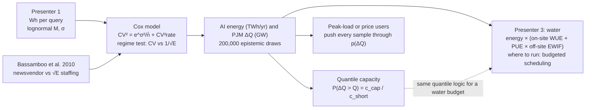
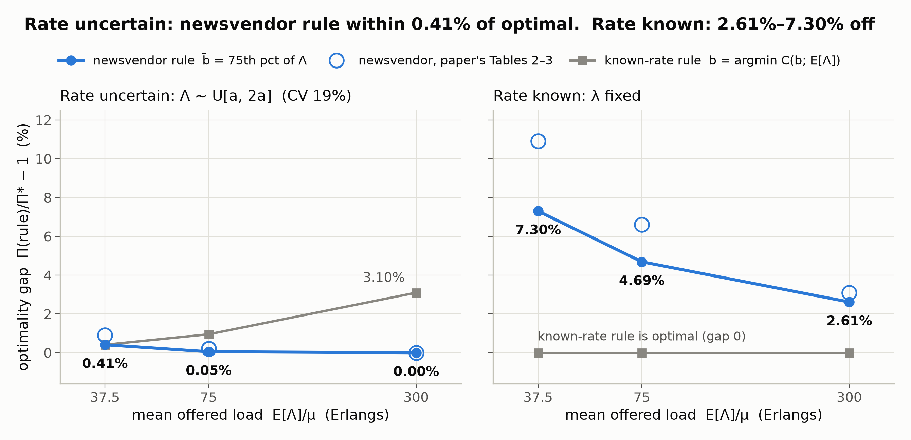
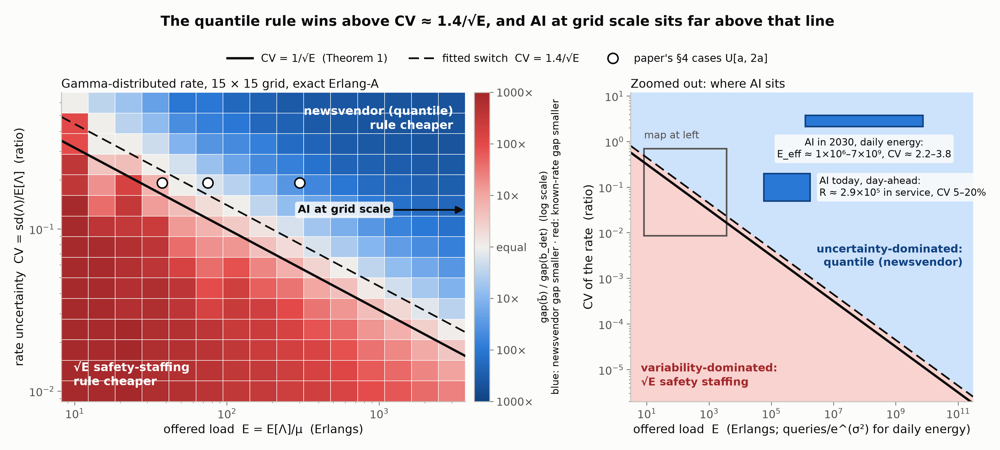
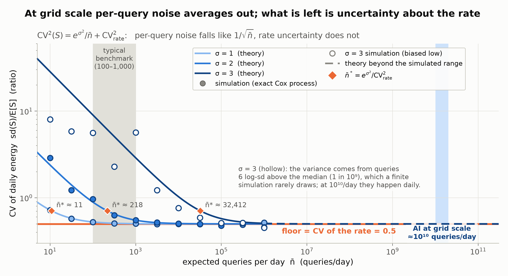
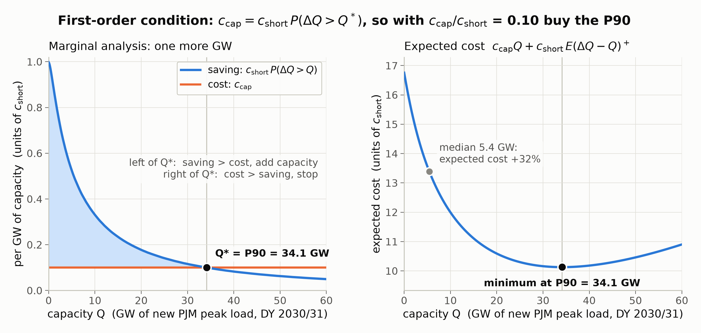
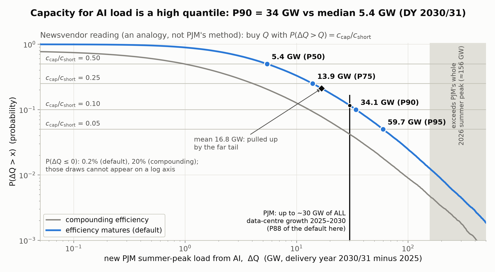

# Guide: AI load, parameter uncertainty and capacity sizing

> **Run:** {{run/timestamp|raw}} · **git commit:** `{{run/git_commit|raw}}` · rendered from `docs/GUIDE_TEMPLATE.md` by `scripts/build_guide.py`.
> Every number below is read from `outputs/summary.json` (or quoted from a cited source, with the citation next to it). Presenter 1's per-query numbers: **{{partD/presenter1_status|raw}}**.

---

## 1. Overview

**Question.** How much new summer-peak load and electricity use will AI add to PJM by 2028 and 2030, and how much capacity should be planned for when the forecast itself is uncertain?

**Answer.** At ~10¹⁰ queries a day the randomness of individual queries averages out completely, so what is left is uncertainty about volume, query mix and efficiency, and it is large. New PJM peak load for 2030/31 has a median of {{partD/quantiles/2030_matures/P50|f1}} GW but a P90 of {{partD/quantiles/2030_matures/P90|f1}} GW. Because rate uncertainty dominates, Bassamboo et al.'s result applies: the capacity to buy is a **quantile** of that distribution set by a cost ratio (a newsvendor rule), not the median plus a square-root safety margin. The same draws give AI's electricity use (PJM median {{partD/energy/cases/2030_matures/PJM/E/P50|f0}} TWh/yr in 2030, P90 {{partD/energy/cases/2030_matures/PJM/E/P90|f0}}), which presenter 3 turns into water.



The talk runs in three parts. **Part I** derives the newsvendor first-order condition, which makes capacity a quantile, and checks it by brute force on the ΔQ samples (Fig. 0). **Part II** is the demo, in four computational parts with one figure each. **Part III** writes the whole method as eight lines of pseudocode (§8) and runs it once more with fresh random numbers. The demo parts: **A** reproduce the paper's §4 (Fig. 1); **B** map where the newsvendor rule beats square-root staffing (Fig. 2); **C** show that AI queries form a Cox process whose per-query noise vanishes at grid scale (Fig. 3); **D** build the distributions of new PJM peak load ΔQ and of AI electricity use, read capacity as a quantile (Fig. 4), and hand the energy samples to presenter 3, who turns them into water.

---

## 2. Knowledge map

| # | Concept | Precise statement | Where used (file::function · notebook cell) | Why it is needed | Source | How it was verified |
|---|---|---|---|---|---|---|
| 1 | Poisson process; superposition, thinning | N(t) ~ Poisson(λt), independent increments; Σ of independent Poisson(λᵢ) is Poisson(Σλᵢ); independent marking with prob. pⱼ gives independent Poisson(pⱼλ) | `cox.py::simulate_daily_energy`, `erlang_a.py` (arrivals) · cells 2, 4 | Many users and providers merge into one request stream; splitting by query type keeps each stream Poisson | Ross, *Intro. to Probability Models*, ch. 5 (section numbers VERIFY); Bassamboo et al. 2010 §3 p.7 | `test_cox.py::test_simulated_mean_and_variance_match_theory` (CV_rate = 0 cases) |
| 2 | Cox (doubly stochastic, mixed) Poisson process | N \| Λ ~ Poisson(Λ) ⇒ E N = EΛ, Var N = EΛ + Var Λ | `cox.py::draw_rate_multipliers`, `erlang_a.py::expected_cost` · cells 2, 4 | Forecast error makes the rate itself random: the paper's arrival model and ours | Bassamboo et al. 2010 §3 p.7; Jongbloed & Koole 2001 | z-tests in `test_cox.py` (CV_rate > 0) |
| 3 | Compound Poisson sum, Wald, conditional variance | S = Σ_{i≤N} Xᵢ: E[S\|ξ] = n̄ξ·m₁, Var(S\|ξ) = n̄ξ·m₂ | `cox.py::daily_energy_moments` · cell 4 | Daily energy is a random number of random energies | Ross ch. 5 (VERIFY section) | `test_simulated_mean_and_variance_match_theory` |
| 4 | Total expectation / total variance; aleatory vs epistemic | Var S = E[Var(S\|ξ)] + Var(E[S\|ξ]) = n̄m₂ + n̄²m₁²CV²rate | `cox.py::daily_energy_moments`; `pjm_load.py` (epistemic only) · cell 4 | Separates per-query noise (aleatory) from not knowing the rate (epistemic) | Hoffman & Hammonds 1994; Der Kiureghian & Ditlevsen 2009 | `test_cox.py::test_crossover_balances_the_two_variance_parts`, `test_rao_blackwell_keeps_mean_and_lowers_variance` |
| 5 | Lognormal: moments, mean vs median, tail share | X = M e^{σZ}: E X = M e^{σ²/2}, E X² = M² e^{2σ²}; share of energy above the z-quantile = 1 − Φ(z − σ) | `cox.py::lognormal_moments`, `energy_share_above_quantile`; `pjm_load.py::mean_wh_chat` · cell 1 | Presenter 1's per-query energy; only the mean survives aggregation | Standard; presenter 1 | `test_lognormal_moment_formulas`, `test_energy_share_above_quantile` |
| 6 | Law of large numbers; CLT scaling | CV of a sum of n i.i.d. terms ∝ 1/√n; here CV²(S) = e^{σ²}/n̄ + CV²rate | `cox.py::cv_daily_energy`, `simulate_cv_curve` · cell 4, Fig. 3 | Shows the per-query noise vanishes at grid scale but the rate floor does not | Standard | `test_cv_formula_and_floor`; simulation in Fig. 3 |
| 7 | Birth–death chain, detailed balance, Erlang-A, flow balance | π(n) ∝ Π_{k≤n} λ/d(k), d(n) = min(n,b)μ + (n−b)⁺γ; λ = μE[min(N,b)] + γE[Q] | `erlang_a.py::queue_moments` · cell 2 | Exact cost of any capacity level for a given rate | Bassamboo et al. 2010 §3 p.7, eq. (1) | `test_erlang_a.py`: M/M/∞, b = 0, flow balance (1e-9), monotone E[Q], truncation < 1e-12 |
| 8 | Integer optimization of a unimodal cost | Π discretely convex ⇒ b* = min{b : Π(b+1) − Π(b) ≥ 0} | `capacity_rules.py::optimal_capacity`, `brute_force_optimal` · cell 2 | b* for every case and grid cell | Bassamboo et al. 2010, footnote p.7 (convexity), p.10 (search) | `test_cost_unimodal_in_b`, `test_bisection_equals_brute_force` |
| 9 | Fluid approximation and newsvendor | E[(N−b)⁺] ≈ E[(Λ−μb)⁺]/γ ⇒ Π̄(b) = (p + h/γ)E[(Λ−μb)⁺] + cb ⇒ P(Λ > μb̄) = c/(μ(p + h/γ)) | `capacity_rules.py::newsvendor_capacity`; `erlang_a.py::newsvendor_cost` · Part I, cell 2 | The rule under test, derived in Part I; the same logic gives quantile capacity | Bassamboo et al. 2010 eqs. (2)–(3), pp.7–8 | `test_newsvendor_uniform_cases_match_paper`, `test_newsvendor_all_paper_table_entries` |
| 10 | Square-root safety staffing (Halfin–Whitt / QED) | Known λ: b ≈ E + β√E, β = O(1) | `capacity_rules.py::known_rate_capacity`, `fit_safety_factor` · cell 2 | The competing rule; right when the rate is known | Halfin & Whitt 1981; Bassamboo et al. 2010 §4.2 pp.10–11 | `test_known_rate_rule_is_optimal_for_fixed_rates`; β in §4.1 |
| 11 | Bassamboo et al. Theorem 1 | CV ≫ 1/√E ⇒ Π(b̄) = Π* + O(1/CV); CV ≪ 1/√E or ≍ ⇒ Π(b̄) = Π* + O(√E) (verbatim in §2.11) | Fig. 2; `capacity_rules.py::regime_grid`, `boundary_analysis` · cell 3 | Tells us which regime AI is in | Bassamboo et al. 2010 §5, p.15 | Regime map: switch at CV ≈ {{partB/meta/boundary/gamma/kappa_median|f2}}/√E |
| 12 | Monte Carlo: quantiles, bootstrap SEs, seeds | q̂ₚ = empirical quantile; SE by bootstrap; mean SE = s/√n; probability SE = √(p̂(1−p̂)/n) | `pjm_load.py::quantile_table`, `simulate` · cell 5 | Every ΔQ number comes with its Monte Carlo error | Standard | `test_quantiles_stable_across_seeds` |
| 13 | Rao–Blackwellization (conditional Monte Carlo) | E[E[S\|θ]] = E S, Var E[S\|θ] = Var S − E Var(S\|θ) ≤ Var S | `pjm_load.py` (uses E[S\|θ]); `cox.py::rao_blackwell_demo` | Lets the grid model skip the ~10¹⁰-query inner loop | Standard | `test_rao_blackwell_keeps_mean_and_lowers_variance` |
| 14 | Gompertz growth vs geometric Brownian motion; volume vs efficiency | ln G_T = ln g₁ (1 − e^{−λT})/λ (bounded: G_∞ = g₁^{1/λ}); GBM: ln G_T ~ N(μT, s²T) | `pjm_load.py::gompertz`, `growth_factor`, `efficiency_factor` · cell 5 | Volume growth and efficiency race; the toggle changes the winner | Spec §6 (two-point fit to Google token growth) | `test_fermi_ladder_matches_prototype` |
| 15 | Fenton–Wilkinson lognormal approximation | Σ lognormals ≈ lognormal with s² = ln(1 + v/m²), μ = ln m − s²/2 | `pjm_load.py::log_moments`, `lognormal_check` | Cross-check of the Monte Carlo | Fenton 1960 | §4.5: FW vs exact log-moments vs MC; `test_lognormal_approximation_with_exact_mix_moments` |
| 16 | Jensen's inequality; why the handoff is a distribution | p convex ⇒ E[p(X)] ≥ p(E X); p linear ⇒ equality | Handoff README · cell 6 | Linear consequences (water = intensity × energy) need only the mean; budgets and convex prices need the distribution | Standard | `test_jensen_gap_for_a_convex_price_curve` |
| 17 | Electricity units, energy vs power, peak vs average, coincidence, PUE | P[GW] = N[/day] · e[Wh] / 24 h / 10⁹; E[TWh/yr] = P_avg[GW] × 8.76; peak = average × κ; PUE = facility/IT energy | `pjm_load.py::to_gw`, `energy_twh`, `scope_factor` · cells 5–6 | Turning Wh per query into GW of peak load and TWh of energy | Spec §6; Elsworth et al. 2025 (PUE included in 0.24 Wh) | `test_units_hand_calculation` (35.4 MW), `test_energy_units_hand_calculation`, `test_energy_consistent_with_peak_load_and_regions` |
| 18 | PJM capacity market basics | Delivery year June–May; capacity bought ahead from the load forecast; firm vs non-firm large loads | `params.py::DELIVERY_YEARS`, `PJM_DC_GROWTH_GW` · cells 5–6 | Sets the horizon T and the 30 GW yardstick | PJM LAS (24 Nov 2025); PJM 2026 Load Forecast Report (as cited in spec §12) | — (definitions) |
| 19 | Newsvendor reading of grid capacity (**analogy**) | min c_cap·Q + c_short·E(ΔQ − Q)⁺ ⇒ P(ΔQ > Q) = c_cap/c_short | `pjm_load.py::quantile_capacity`, `position_of`, `newsvendor_check` · Part I, cell 5, Part III, Figs. 0 and 4 | Turns the ΔQ distribution into a capacity decision | Bassamboo et al. 2010 eq. (3) by analogy | `test_quantile_capacity_is_the_fractile`, `test_newsvendor_check_minimizer_is_the_quantile`, `test_newsvendor_cost_curve_matches_brute_force` |
| 20 | Sobol indices | Sᵢ = Var E[Y\|Xᵢ]/Var Y; additive independent Y ⇒ Sᵢ = Var gᵢ/Var Y; product of lognormals ⇒ Sᵢ = (e^{sᵢ²}−1)/(e^{S²}−1) | `scripts/run_all.py::sobol_part` | Which uncertainties drive ΔQ | Sobol' 2001; Saltelli et al. 2010 | SALib vs closed form within {{derived/sobol_max_diff|sci1}} |
| 21 | Static vs dynamic decisions under uncertainty (the bridge to presenter 3) | Plan before Λ is known ⇒ a quantile (newsvendor); operate after demand arrives ⇒ online control that keeps a long-run budget (virtual queue, Lyapunov drift) | Notebook cell 6; handoff README | Connects capacity planning to water-aware scheduling | Bassamboo et al. 2010 §7(a), pp.21–22; presenter 3's references | — (concept) |
| 22 | Operational water footprint and the energy boundary | Water = Σₜ eₜ[ρ_s1,t + θₜρ_s2,t] (e = server energy); with facility energy F = θe: Water = F(ρ_s1/θ + ρ_s2) | `pjm_load.py::energy_twh`, `write_energy_csvs` · cell 6 | What presenter 3 needs from us (energy, at an agreed boundary) | Li et al. 2025 §3.1 p.4 | Formula checked in the paper; boundary stated in the handoff |

### 2.1 Poisson process; superposition and thinning
A Poisson process with rate λ has independent increments and N(t) ~ Poisson(λt). Its probability generating function is E z^{N(t)} = exp(λt(z − 1)). **Superposition:** for independent processes with rates λ₁, …, λ_k the product of generating functions is exp((Σλᵢ)t(z − 1)), so the merged stream is Poisson with rate Σλᵢ. **Thinning:** if each arrival is independently of type j with probability pⱼ, the type-j counts are independent Poisson processes with rates pⱼλ. Superposition is why requests from millions of independent users form one Poisson stream; thinning is why splitting that stream into chat, reasoning and agentic requests keeps each part Poisson, and why the energy per request of the mixed stream is the weighted average `mix_t = (1 − w_R − w_A) + w_R·r + w_A·a` (in chat units).

### 2.2 Doubly stochastic (Cox, mixed) Poisson process
If the rate Λ is itself random and N | Λ ~ Poisson(Λ), then E N = EΛ and, by the law of total variance, Var N = E[Var(N|Λ)] + Var(E[N|Λ]) = EΛ + Var Λ > E N. The counts are **overdispersed**; CV²(N) = 1/EΛ + CV²(Λ). The first term is Poisson noise and shrinks as the volume grows; the second does not. This is the paper's arrival model (§3, p.7), motivated by call-centre data whose empirical CVs (22.3–148.1%) dwarf the Poisson values (3.3–8.5%) (Table 1, p.3). Gamma mixing gives a negative binomial count, which is what `cox.draw_rate_multipliers` produces.

### 2.3 Compound Poisson sums; Wald's identity; conditional variance
Let S = Σ_{i≤N} Xᵢ with N ~ Poisson(ν) independent of i.i.d. Xᵢ. Wald's identity gives E S = ν E X. Conditioning on N: Var S = E[N Var X] + Var(N E X) = ν Var X + ν(E X)² = ν E X². With ν = n̄ξ (Cox) this gives E[S | ξ] = n̄ξ m₁ and Var(S | ξ) = n̄ξ m₂, where m₂ = E X² (not Var X). `cox.daily_energy_moments` implements these, and the simulation in `cox.simulate_daily_energy` reproduces them (z-tests at the 0.1% level).

### 2.4 Laws of total expectation and variance; aleatory vs epistemic uncertainty
E S = E[E[S|ξ]] = n̄ m₁ and Var S = E[Var(S|ξ)] + Var(E[S|ξ]) = n̄ m₂ + n̄² m₁² CV²rate. The first term is **aleatory** (the irreducible randomness of individual queries, given the rate); the second is **epistemic** (we do not know the rate). The distinction (Hoffman & Hammonds 1994; Der Kiureghian & Ditlevsen 2009) decides what a planner can do: aleatory risk is pooled away by scale, epistemic risk is not, but it can be reduced by learning (better forecasts). In Part D every prior is epistemic. At 10¹⁰ queries per day the aleatory share of Var S is at most {{derived/max_aleatory_share_1e10|sci1}} (σ = 3 with a 5% rate CV), so dropping it is harmless (§2.13).

### 2.5 Lognormal distribution
X = M e^{σZ}, Z ~ N(0,1): the median is M, E X = M e^{σ²/2}, E X² = M² e^{2σ²}, CV² = e^{σ²} − 1. Mean/median = e^{σ²/2} = {{partC/mean_over_median/sigma1|f2}} for σ = 1, {{partC/mean_over_median/sigma2|f1}} for σ = 2 and {{partC/mean_over_median/sigma3|f0}} for σ = 3. **Tail share:** completing the square in the Gaussian integral gives E[X; X > M e^{σz}]/E X = 1 − Φ(z − σ). The 10% most energy-hungry queries therefore use {{partC/energy_share_top10pct/sigma1|pct0}} of the energy at σ = 1, {{partC/energy_share_top10pct/sigma2|pct0}} at σ = 2 and {{partC/energy_share_top10pct/sigma3|pct0}} at σ = 3; the top 1% use {{partC/energy_share_top1pct/sigma1|pct0}}, {{partC/energy_share_top1pct/sigma2|pct0}} and {{partC/energy_share_top1pct/sigma3|pct0}}. This is why the grid sees the mean, not the median: summed over billions of queries only m₁ = M e^{σ²/2} matters.

### 2.6 Law of large numbers and CLT scaling
For a sum of n i.i.d. terms with finite variance, CV = CV(X)/√n → 0 (LLN), and the standardized sum tends to a normal (CLT). For the Cox sum, CV²(S) = e^{σ²}/n̄ + CV²rate: the per-query term falls like 1/n̄ and the rate term is a floor. The two are equal at the crossover n̄* = e^{σ²}/CV²rate: {{partC/crossover_cv_rate_0.5/sigma1|int}}, {{partC/crossover_cv_rate_0.5/sigma2|int}} and {{partC/crossover_cv_rate_0.5/sigma3|int}} queries for σ = 1, 2, 3 at CV_rate = 0.5 ({{partC/crossover_cv_rate_1/sigma1|f0}}, {{partC/crossover_cv_rate_1/sigma2|f0}} and {{partC/crossover_cv_rate_1/sigma3|int}} at CV_rate = 1). Mapping to the paper's axis: the per-query noise 1/√E_eff with E_eff = n̄/e^{σ²} plays the role of the Poisson noise 1/√E. **Caveat:** with heavy tails the CLT needs very large n; in the σ = 3 simulation (Fig. 3) the sample CV stays below the theory across most of the simulated range ({{derived/sim_sigma3_ratio_at_10|f2}}× theory at n̄ = 10, {{derived/sim_sigma3_ratio_at_1e6|f2}}× at 10⁶).

### 2.7 Birth–death chains, detailed balance, the Erlang-A model, flow balance
Given Λ = λ, the number in system N is a birth–death chain: birth rate λ, death rate d(n) = min(n, b)μ + (n − b)⁺γ (served customers leave at rate μ each; waiting customers abandon at rate γ each). Detailed balance π(n−1)λ = π(n)d(n) gives π(n) ∝ Π_{k≤n} λ/d(k), which `erlang_a.queue_moments` evaluates in log space for many λ at once (the cumulative sum of log d is shared). Because d is non-decreasing, the mass beyond n_max is at most π(n_max)·r/(1 − r) with r = λ/d(n_max + 1); n_max grows until this bound and the matching E[Q] bound are below 10⁻¹². Queue Q = (N − b)⁺, abandonment rate γE[Q], cost C(b; λ) = cb + (h + pγ)E[Q]. **Flow balance** (arrivals = services + abandonments): λ = μE[min(N, b)] + γE[Q], checked to 10⁻⁹. Special cases used as tests: γ = μ gives M/M/∞ with N ~ Poisson(λ/μ); b = 0 gives N ~ Poisson(λ/γ).

### 2.8 Integer optimization of a unimodal cost
The paper notes that E[N − b]⁺ is convex in b, so Π is convex (footnote p.7). On integers we checked discrete convexity on a grid for the §4 cases: the smallest second difference is {{partA/summary/min_second_difference|sci1}}, i.e. zero up to rounding (`test_cost_unimodal_in_b`). For a discretely convex sequence the minimizer is the smallest b with Π(b+1) − Π(b) ≥ 0, so `optimal_capacity` bisects on the sign of that forward difference (O(log range) evaluations, equivalent to an integer golden-section search). The paper's own method, evaluating a large set of b (p.10), is `brute_force_optimal`; the two agree on all twelve Table 2–4 cases.

### 2.9 Fluid approximation and the newsvendor problem
Ignore Poisson variability: fluid arrives at rate Λ and is served at rate μb, so the excess (Λ − μb)⁺ must abandon. Equating with the exact abandonment rate γE[Q] gives E[Q] ≈ E[(Λ − μb)⁺]/γ (p.8) and the cost Π̄(b) = (p + h/γ)E[(Λ − μb)⁺] + cb (eq. 2). Since d/db E[(Λ − μb)⁺] = −μP(Λ > μb), setting Π̄′(b) = c − μ(p + h/γ)P(Λ > μb) = 0 gives the **critical fractile** P(Λ > μb̄) = c/(μ(p + h/γ)) (eq. 3); the second derivative μ²(p + h/γ)f_Λ(μb) ≥ 0 makes it a minimum. With the §4 parameters it is (1/3)/(4/3) = {{partA/params/fractile|f2}}, so b̄ is the 75th percentile, rounded down as in every table of the paper. Our implementation uses an exact version of this split: E[Q] = (λ − μb)⁺/γ + D(λ, b) with D ≥ 0 (by flow balance D = (μ/γ)E[idle servers] above μb), so Π = Π̄ + (h + pγ)E[D(Λ, b)]. D is negligible more than ~12√b from μb, which makes wide rate distributions cheap to integrate (§4.2).

### 2.10 Square-root safety staffing (Halfin–Whitt / QED regime)
With a known rate the number in system fluctuates by about √E around E = λ/μ, so the best capacity is the offered load plus a safety margin proportional to √E: b ≈ E + β√E (paper eq. 4, p.11). Halfin & Whitt (1981) showed that with this scaling the probability of waiting stays strictly between 0 and 1 as the system grows: the "quality and efficiency driven" (QED) regime. Our known-rate rule gives β = {{partA/summary/beta_by_case/lambda = 37.5|f2}}, {{partA/summary/beta_by_case/lambda = 75|f2}} and {{partA/summary/beta_by_case/lambda = 300|f2}} for λ = 37.5, 75 and 300 (least-squares fit {{partA/summary/beta_fit_fixed_cases|f2}}), consistent with the paper's "β ≈ 1·√λ" (p.10). The rule is right when the rate is known (variability-dominated regime) and wrong when it is not: on U[200, 400] it is {{derived/kr_gap_300|pct1}} above optimal.

### 2.11 Bassamboo et al. Theorem 1 (stated exactly as in the paper, p.15)
Setting (p.13–14): a sequence of systems indexed by λ = EΛ → ∞; CV_λ = σ_λ/λ; E_λ = λ/θ (θ is the paper's service rate, our μ); Assumption 1: Λ = λ + σ_λX with X of zero mean, unit variance and bounded density; u_λ ≫ v_λ means u_λ/v_λ → ∞, and ≍ means bounded above and away from zero.

> **Theorem 1 (Uncertainty versus stochastic variability).**
> (a) (Uncertainty-dominated regime.) If the coefficient of variation of the arrival rate satisfies CV_λ ≫ 1/√E_λ, then the newsvendor prescription (8) is O(1/CV_λ)−optimal. That is, Π_λ(b̄_λ) = Π*_λ + O(1/CV_λ).
> (b) (Variability-dominated regime.) If the coefficient of variation of the arrival rate satisfies CV_λ ≪ 1/√E_λ, then the newsvendor prescription (8) is O(√E_λ)−optimal. That is, Π_λ(b̄_λ) = Π*_λ + O(√E_λ).
> (c) If the coefficient of variation of the arrival rate satisfies CV_λ ≍ 1/√E_λ (i.e., variability and uncertainty are balanced), then the newsvendor prescription (8) is O(√E_λ)−optimal. That is, Π_λ(b̄_λ) = Π*_λ + O(√E_λ).

Reading it correctly: the statements bound the **absolute** gap. Since Π* grows like E, the relative gap is O(1/(CV·E)) in (a) and O(1/√E) in (b). The theorem is about orders of magnitude, not a sharp line; the constant in front of 1/√E is not given. Our regime map finds the switch at CV ≈ {{partB/meta/boundary/gamma/kappa_median|f2}}/√E: same slope as the theorem's line, a constant of about 1.4.

### 2.12 Monte Carlo estimation: quantiles, bootstrap standard errors, seeds
The p-quantile is estimated by the empirical quantile of n = {{partD/n_draws|int}} draws. Its asymptotic standard error is √(p(1 − p)/n)/f(qₚ), which needs the unknown density f; we use the **bootstrap** instead (resample the draws with replacement {{partD/quantiles/2030_matures/n_boot|int}} times, take the standard deviation of the re-estimated quantile). Means use s/√n and probabilities √(p̂(1 − p̂)/n). The seed is fixed ({{partD/seed|raw}}), and the same parameter draws serve both delivery years and both efficiency structures (common random numbers), so differences between cases are not Monte Carlo noise. Example: P90 for 2030/31 (default) = {{partD/quantiles/2030_matures/P90|f2}} ± {{partD/quantiles/2030_matures/P90_se|f2}} GW. Changing the seed moves every quantile by less than three combined standard errors (`test_quantiles_stable_across_seeds`).

### 2.13 Rao–Blackwellization (conditional Monte Carlo)
For any parameter vector θ, E[E[S|θ]] = E S and Var(E[S|θ]) = Var S − E[Var(S|θ)] ≤ Var S. Replacing the simulated daily total by its conditional mean Λ(θ)·m₁(θ) keeps the mean exactly and removes only the aleatory part of the variance. Part C shows that part is negligible at grid scale (at most {{derived/max_aleatory_share_1e10|sci1}} of Var S at 10¹⁰ queries/day), so the PJM model needs no inner loop over ~10¹⁰ queries. In the worked example (n̄ = 1,000, σ = 2, CV_rate = 0.5) the Rao–Blackwellized variance is {{derived/rb_var_ratio|f3}} of the raw one (theory: {{derived/rb_theory_ratio|f3}}).

### 2.14 Gompertz growth vs geometric Brownian motion; the volume-vs-efficiency race
Gompertz: the log growth rate starts at ln g₁ per year and decays at rate λ, d ln G/dt = ln(g₁)e^{−λt}, so ln G_T = ln g₁ (1 − e^{−λT})/λ and growth saturates at G_∞ = g₁^{1/λ}. A geometric Brownian motion, d ln G = μ dt + s dW, would instead give unbounded growth with log-variance s²T growing in time; it models *stochastic* fluctuations, whereas our uncertainty is *epistemic* (we do not know g₁ and λ). Efficiency either matures the same way (H_T = exp(ln h (1 − e^{−λT})/λ), default) or compounds (H_T = hᵀ). New load ∝ G_T·mix_T/H_T − mix₀: a race between volume and mix on one side and efficiency on the other. At the prior medians for 2030/31, volume grows ×{{derived/growth_2030|f2}}, the mix shift adds ×{{derived/mix_shift_2030|f2}}, and efficiency multiplies it by {{derived/eff_2030|f3}} (matures) or {{derived/eff_2030_comp|f3}} (compounding). The toggle therefore moves the 2030/31 median from {{partD/quantiles/2030_matures/P50|f2}} to {{partD/quantiles/2030_compounding/P50|f2}} GW.

### 2.15 Fenton–Wilkinson lognormal approximation
Fenton (1960) approximates a sum of lognormals by one lognormal with the same mean m and variance v: s² = ln(1 + v/m²), μ = ln m − s²/2. We use it for the mix sum, multiply the independent factors on the log scale, and compare the resulting lognormal for P_T with the Monte Carlo. FW matches the **linear** mean and variance, which the heavy-tailed agentic term (log-sd of w_A·a ≈ {{derived/agentic_term_log_sd|f2}}) dominates, so it overstates Var ln(mix): for 2030/31 the approximation is off by {{derived/fw_P10_reldiff_2030|spct0}} at P10, {{derived/fw_P50_reldiff_2030|spct0}} at P50 and {{derived/fw_P90_reldiff_2030|spct0}} at P90. Replacing FW by the exact log-moments of the mix (4-D Gauss quadrature) brings every quantile within {{derived/exact_max_abs_reldiff|pct1}}, so ln P_T is close to normal and the factor decomposition is right (table in §4.5).

### 2.16 Jensen's inequality and why the handoff is a distribution
For convex p, E[p(X)] ≥ p(E X), with a gap that grows with the spread of X; for linear p the two are equal. Which case applies decides what downstream users need:
- **Water (presenter 3)** is linear in energy for fixed intensities (§2.22), so *expected* water needs only expected energy. But a water **budget** is a threshold: the probability of exceeding it, P(W > budget), depends on the whole distribution, and the same quantile logic as capacity applies. If the budget must hold with probability 1 − α, plan for the (1 − α) quantile of water use, not the median.
- **Prices and bills.** A capacity price rises convexly with new load where supply is steep, so the expected price impact exceeds the price at the expected (and even more at the median) load. Anyone pricing ΔQ must push every sample through p (`test_jensen_gap_for_a_convex_price_curve` checks this on our samples with a convex price curve).

That is why the handoff is {{partD/n_draws|int}} paired samples per case, not a single number. The tail caveat in §5 matters for both uses.

### 2.17 Electricity units and power concepts
Energy (Wh) is power (W) × time. Average power = energy per day ÷ 24 h, so P[GW] = N[queries/day] × e[Wh/query] ÷ 24 h ÷ 10⁹ W/GW. Hand check: 2.5×10⁹ prompts/day × 0.34 Wh ÷ 24 h = {{derived/ladder_start|f1}} MW (`test_units_hand_calculation`). **Energy** over a year is average power × 8,760 h: 1 GW of average load is 8.76 TWh/yr, or 24 GWh/day. Water and emissions scale with energy; capacity markets scale with the peak. Capacity markets care about the **peak**, so average load is multiplied by a summer-peak coincidence factor κ = 1.0–1.3 (spec §6: Oviedo et al. S5 gives 1.235; PJM's flat 70% utilization corresponds to about 1.0). **PUE** (power usage effectiveness) is total facility energy divided by IT energy. Google's 0.24 Wh median already includes data-centre overhead and idle machines (Elsworth et al. 2025, abstract, re-checked from the PDF in this build), so when M_c leans on that number the fleet-overhead factor β should be near its lower end of 1.0.

### 2.18 PJM capacity market basics
PJM delivery years run June to May; capacity for a delivery year is procured ahead of time on the basis of PJM's load forecast, which is why our horizon is summer 2028 for DY 2028/29 (T = 3) and summer 2030 for DY 2030/31 (T = 5). Large data-centre loads are classed as firm or non-firm (curtailable). Numbers as cited in the spec (§12; documents checked by the author, not re-opened in this build): PJM hosts about 40% of US data centres in 2025, its load-adjustment process supports up to ~30 GW of data-centre growth 2025–2030 with minimum 36-month ramps, and non-firm load counts as zero before 2030 and half from 2030 in most zones (PJM Load Analysis Subcommittee, 24 Nov 2025). The 2026 Load Forecast Report gives a 2036 summer peak of 222,106 MW, +65,733 MW over ten years, so the 2026 forecast peak is about {{partD/pjm_summer_peak_2026_GW|f0}} GW. A price model for new load, if the group keeps one, would take the ΔQ samples (§2.16).

### 2.19 The newsvendor reading of grid capacity (an analogy)
If each GW of capacity costs c_cap and each GW of unmet peak load costs c_short, then choosing Q to minimize c_cap·Q + c_short·E[(ΔQ − Q)⁺] gives, exactly as in §2.9, P(ΔQ > Q) = c_cap/c_short: **capacity is a quantile of ΔQ**. In textbook terms the overage cost is c_o = c_cap and the underage cost c_u = c_short − c_cap, so F(Q*) = c_u/(c_u + c_o); the median is optimal only when c_o = c_u, i.e. when a shortfall costs twice a unit of capacity. The derivation does not need a density: for the empirical law of the draws the minimizer is the order statistic at rank 1 − c_cap/c_short, which is how §4.5 checks it by brute force (Fig. 0). With a cost ratio of 0.10 that is P90 = {{partD/quantile_capacity/2030_matures/0.10|f1}} GW for 2030/31, against a median of {{partD/quantile_capacity/2030_matures/0.50|f1}} GW. This is an **analogy, not PJM's method**: PJM procures against a sloped demand curve and a reliability requirement, not a single cost ratio. What carries over is the logic: when uncertainty about the rate dominates, the hedge must be sized to that uncertainty, not to √E. Read backwards, PJM's ~30 GW sits at the {{partD/pjm_30GW/2030_matures/quantile|pct1}} quantile of our ΔQ (implied ratio {{partD/pjm_30GW/2030_matures/implied_cost_ratio|f3}}). That 30 GW covers **all** data-centre growth, not AI alone, so the comparison is indicative only.

### 2.20 Sobol indices
For Y = f(X₁, …, X_k) with independent inputs, the first-order index Sᵢ = Var(E[Y|Xᵢ])/Var Y is the share of variance explained by Xᵢ alone, and the total index S_Tᵢ = E[Var(Y|X₋ᵢ)]/Var Y includes all its interactions. If Y = Σ gᵢ(Xᵢ) is additive, Sᵢ = Var gᵢ/Var Y and the Sᵢ sum to 1. ln P_T is a sum of independent group log-factors except that growth and (maturing) efficiency share λ, which leaves a small interaction ({{sobol/matures/log_scale/sum_closed_form|f3}} explained by first-order terms). We estimate the indices with SALib (Saltelli 2010 design, {{sobol/matures/n_model_runs|int}} model runs per structure) on parameter groups, and compare with the closed form computed from exact log-variances: the largest difference is {{derived/sobol_max_diff|sci1}}. On the linear scale a product of independent lognormals has Sᵢ = (e^{sᵢ²} − 1)/(e^{S²} − 1); our group factors are only approximately lognormal, and agreement there is rough (§4.7).

### 2.21 Static vs dynamic decisions under uncertainty (the bridge to presenter 3)
Bassamboo et al.'s capacity b is chosen **before** the rate Λ is revealed: a static decision whose answer is a quantile of Λ (§2.9). The paper's own discussion points to the dynamic side as follow-up work: a quasi-static routing policy paired with the newsvendor capacity is nearly optimal in the uncertainty-dominated regime (§7(a), pp.21–22). Presenter 3's second reference (Islam et al. 2017, *Water-constrained geographic load balancing in data centers*, as she describes it; not opened in this build) takes that dynamic side for water: a cost-minimization problem with a long-run water budget, turned into an online scheduling rule (WATCH) by a virtual water-deficit queue and a Lyapunov drift argument. The two views fit together:
- **Plan** (this demo): size capacity so that a constraint holds with high probability, so the answer is a quantile of the uncertain demand.
- **Operate** (presenter 3): once demand arrives, route work across locations so that a budget holds on average, so the answer is a control rule.

Siting is the hinge. Here the US and PJM shares are uncertain *parameters* (s_US, s_PJM); in presenter 3's model, where computing runs is the *decision*. Bridge sentence: *"I've shown how much to plan for before we know the demand. Presenter 3 shows what each of those kilowatt-hours costs in water, and how choosing where the computing runs keeps that within a budget."*

### 2.22 Operational water footprint and the energy boundary
Li et al. (2025, §3.1, p.4) write the operational water footprint of an AI workload over time slots t as Water = Σₜ eₜ·[ρ_s1,t + θₜ·ρ_s2,t]. Here eₜ is **server** energy, ρ_s1 the on-site water usage effectiveness (litres evaporated for cooling per kWh of server energy, higher in hot weather), θ the PUE, and ρ_s2 the off-site electricity water intensity factor (EWIF, litres per kWh generated, set by the grid's fuel mix). Our energies are close to **facility** energy F = θe, because the per-query measurements include overhead (Google's 0.24 Wh does). Substituting gives Water = F·(ρ_s1/θ + ρ_s2): divide by PUE in the on-site term only, or PUE is counted twice. Their Table 1 lists PUE 1.17, on-site WUE 0.55 L/kWh and off-site EWIF 3.142 L/kWh for the U.S. average, and 1.14, 0.14 and 2.385 for Virginia (inside PJM). Computing water is presenter 3's part; this demo supplies the energy distribution and states its boundary.

---

## 3. What was done

Distilled from `WORKLOG.md` (timestamps and problems are there).

| Step | Goal | What was done | Inputs | Output files | Key result | Checks passed | Decisions and why |
|---|---|---|---|---|---|---|---|
| 1 | Get and read the paper | Downloaded the PDF from the spec URL; byte-identical to the local copy; read all 37 pages | Spec §2 URL | `refs/paper_notes.md` | Cost convention of the spec = paper's eq. (1); θ = service rate; b̄ rounded down in all 20 table entries | — | Use the paper's convention; floor rounding |
| 2 | Resolve the known discrepancy | Reproduced the prototype; tested γ, θ, c, K variants against Tables 2, 3, 4, 7 | Paper tables | `refs/paper_notes.md` §10 | Table 4 reproduced on all {{derived/table4_n_rows|int}} rows (max \|ΔΠ\| {{partA/summary/table4_max_abs_dPi|f3}}); Tables 2, 3, 7 not reproducible by any single parameter set | scratch fits | Report both sets of numbers; Table 4 is the validation |
| 3 | Exact Erlang-A model | Log-space stationary law with a geometric tail bound; Π(b) for point, uniform, gamma, lognormal rates | — | `src/aicap/erlang_a.py`, `tests/test_erlang_a.py` | Gauss–Legendre 64 vs 128 nodes differ by {{partA/summary/gl_convergence_max_rel_diff_64_vs_128|sci1}} | M/M/∞, b = 0, flow balance, truncation, convexity | Added the exact "split" integrator after finding plain Gauss–Laguerre does not converge for wide gamma rates |
| 4 | Three rules and reproduction | Optimal b* (bisection, brute-force check), newsvendor b̄, known-rate b_det, β | Paper §4 | `capacity_rules.py`, Fig. 1 | Newsvendor gap ≤ {{partA/summary/nv_gap_uncertain_max|pct2}} (uncertain) vs {{partA/summary/nv_gap_known_min|pct1}}–{{partA/summary/nv_gap_known_max|pct1}} (known) | `test_capacity_rules.py` (Table 4, prototype, 43/87/350) | Bisection on the forward difference instead of golden section (equivalent, simpler) |
| 5 | Regime map | 15 × 15 grid, gamma Λ; lognormal robustness; refined-quadrature rerun | §4 costs | `outputs/cache/regime_grid.npz`, Fig. 2 | Switch at CV ≈ {{partB/meta/boundary/gamma/kappa_median|f2}}/√E; lognormal κ = {{partB/meta/boundary/lognormal/kappa_median|f2}} | Convergence {{partB/meta/convergence/max_rel_diff_Pi_bar|sci1}}; same b* in all cells | log₁₀ gap ratio with a 0.01% floor so ties do not blow up |
| 6 | Cox process | Moments, exact simulation, crossover, AI regime numbers | Presenter 1 (placeholders) | `cox.py`, `outputs/cache/cox_sim.npz`, Fig. 3 | σ = 1 simulation within {{derived/sim_sigma1_max_dev|pct1}} of theory; σ = 3 biased low ({{derived/sim_sigma3_min_ratio|f2}}× at worst) | z-tests at 0.1% | Show the σ = 3 bias honestly (heavy tail), with an explanation |
| 7 | PJM ΔQ model | Priors with sources, sampler, quantiles with bootstrap SEs, ladder, lognormal checks | Spec §6 priors | `params.py`, `pjm_load.py` | DY 2030/31 P50 / P90 = {{partD/quantiles/2030_matures/P50|f2}} / {{partD/quantiles/2030_matures/P90|f1}} GW | ladder within 2% of prototype; seed stability; units | Cap w_A ≤ 1 − w_R (binds in {{partD/share_cap_binding_draws|int}} of {{partD/n_draws|int}} draws) |
| 8 | Figures | Projector style; colour-blind-safe palette validated; each figure rendered and inspected | — | `outputs/figures/*.png, *.svg` | Titles state the finding | visual checks | DejaVu Sans (glyph coverage) |
| 9 | Pipeline and handoff | `run_all.py`: everything to `summary.json`; CSVs, JSON, README for presenter 3 | — | `outputs/summary.json`, `outputs/handoff/` | P(ΔQ > 30 GW) = {{partD/quantiles/2030_matures/p_exceed|f3}} (2030/31 default) | `test_end_to_end.py` | Flag the unphysical tail for presenter 3 |
| 10 | Sensitivity (optional) | SALib Sobol on ln P_T by parameter group; closed-form check | — | `summary.json` → `sobol` | S₁: growth {{sobol/matures/log_scale/S1/growth|f2}}, mix {{sobol/matures/log_scale/S1/mix|f2}}, base volume {{sobol/matures/log_scale/S1/base volume|f2}} | SALib vs closed form ≤ {{derived/sobol_max_diff|sci1}} | Log scale is the reliable one |
| 11 | Notebook | Part I (derivation), demo cells 1–5, Part III (pseudocode), bridge cell 6; live toggles for efficiency and the cost ratio | caches | `notebooks/demo.ipynb` | Runs top to bottom in seconds | nbconvert + error scan | Display errors do not fail cells, so the test scans outputs |
| 12 | Documentation | This guide (rendered from `summary.json`), references, README | `summary.json` | `docs/`, `README.md` | — | unresolved placeholders are an error | Numbers only through placeholders |
| 13 | Presenter 3 moved to water | Added annualized energy (global, US, PJM; TWh/yr, no peak factor) to the model, summary and handoff; rewrote the bridge (notebook §6, handoff README, this guide) | Li et al. 2025 §3.1 (water formula) | `outputs/handoff/energy_samples_*.csv`, `README.md`, notebook cell 6 | PJM 2030 median {{partD/energy/cases/2030_matures/PJM/E/P50|f0}} TWh/yr (P90 {{partD/energy/cases/2030_matures/PJM/E/P90|f0}}) | `test_energy_units_hand_calculation`, `test_energy_consistent_with_peak_load_and_regions`, end-to-end | Hand over facility-level energy with the conversion to her formula; no water numbers computed here (her nugget) |
| 14 | Talk order: derivation → demo → pseudocode | Derived the first-order condition (notebook Part I), checked it by brute force on the ΔQ draws, wrote the method as pseudocode (Part III) and reran it with fresh random numbers | Bassamboo et al. eqs. (2)–(3) | `pjm_load.py::newsvendor_check`, Fig. 0, notebook Parts I and III | Minimizer {{partD/newsvendor_check/2030_matures/0.10/argmin_Q|f2}} GW vs P90 {{partD/newsvendor_check/2030_matures/0.10/quantile_Q|f2}} GW; buying the median costs {{partD/newsvendor_check/2030_matures/0.10/excess_median|pct0}} more | `test_newsvendor_check_minimizer_is_the_quantile`, `test_newsvendor_cost_curve_matches_brute_force`, end-to-end | The check is exact by construction for the empirical law: it verifies the calculus and the code, not the model |

---

## 4. Results

### 4.1 Reproduction of the paper's Section 4 (Fig. 1)

Our exact values, with the paper's printed values in parentheses (Tables 2 and 3, p.9). gap(rule) = Π(rule)/Π* − 1.

{{TABLE:repro23}}



**Finding.** With an uncertain rate the newsvendor rule is within {{partA/summary/nv_gap_uncertain_max|pct2}} of optimal (paper: ≤ {{derived/paper_gap_unc_hi|pct1}}); with a known rate it is {{partA/summary/nv_gap_known_min|pct1}}–{{partA/summary/nv_gap_known_max|pct1}} off (paper: {{derived/paper_gap_known_lo|pct1}}–{{derived/paper_gap_known_hi|pct1}}), and the gap shrinks roughly like 1/√E. The known-rate rule shows the mirror image: optimal for fixed rates, but {{derived/kr_gap_300|pct1}} off for U[200, 400], and worse as the scale grows.

**The paper's Table 4 is reproduced exactly** (b* and b̄ identical; Π within {{partA/summary/table4_max_abs_dPi|f3}}), which validates our model, cost and integration:

{{TABLE:repro4}}

**Tables 2, 3 and 7 are not reproduced exactly** (largest |ΔΠ| {{partA/summary/table23_max_abs_dPi|f2}} in Tables 2–3; {{partA/summary/table7_max_abs_dPi|f2}} in Table 7). Our b* is one server lower for every uniform case. See §6 for the investigation. Table 7 (small systems, Appendix C.1, p.36):

{{TABLE:repro7}}

### 4.2 Regime map (Fig. 2)

- **Where the rules switch.** For each offered load E we interpolate the CV at which the cheaper rule changes: κ = CV·√E there has median **{{partB/meta/boundary/gamma/kappa_median|f2}}** (range {{partB/meta/boundary/gamma/kappa_min|f2}}–{{partB/meta/boundary/gamma/kappa_max|f2}}; the largest value is the smallest system, E = 10). The boundary is parallel to the theorem's CV = 1/√E (same slope −½ on log axes) but about 1.4 times higher.
- **Does the theorem's line separate the regions?** Mostly: {{partB/meta/boundary/gamma/frac_agree_theory_line|pct1}} of the {{partB/meta/boundary/gamma/n_cells|int}} cells lie on the side of CV = 1/√E that the theorem predicts, and {{partB/meta/boundary/gamma/frac_agree_fitted_line|pct1}} lie on the predicted side of the fitted line CV = {{partB/meta/boundary/gamma/kappa_median|f2}}/√E. The misclassified cells are a thin band just above 1/√E where the √E rule is still slightly cheaper. This is consistent with the theorem, which fixes the scaling but not the constant.
- **Size of the stakes.** Corners of the grid: at E = 3,000 and CV = 0.6 the newsvendor rule has a relative gap of {{partB/grid_corners/E3000_CV0.6/gap_bar|sci1}} against {{partB/grid_corners/E3000_CV0.6/gap_det|pct1}} for the known-rate rule; at E = 10 and CV = 0.01 the newsvendor rule is {{partB/grid_corners/E10_CV0.01/gap_bar|pct1}} off while the known-rate rule is optimal.
- **Robustness (paper §6 spirit).** With lognormal instead of gamma Λ (same mean and CV), the cheaper rule is the same in {{partB/meta/lognormal_robustness/frac_same_cheaper_rule|pct1}} of cells and κ = {{partB/meta/boundary/lognormal/kappa_median|f2}}.
- **Numerical accuracy.** A rerun with twice the nodes per panel and half the panel width changes Π by at most {{partB/meta/convergence/max_rel_diff_Pi_bar|sci1}} (relative) and no b*.

{{TABLE:kappa}}



### 4.3 Where AI sits (Theorem 1 regime numbers)

Assumptions: 10¹⁰–2×10¹⁰ queries/day globally, σ = 1–3; ChatGPT's 2.5×10⁹ prompts/day (TechCrunch, Jul 2025) as the concurrency example with an ASSUMED mean service time of 10 s (range 2–60 s); day-ahead rate CV 5–20% (ASSUMPTION); delivery-year CV from Part D.

| Scale | Offered load E | Per-query noise 1/√E | Rate CV | CV·√E (switch at ≈ {{partB/meta/boundary/gamma/kappa_median|f1}}) |
|---|---|---|---|---|
| Concurrency today: R = arrivals/s × E[service] | {{partC/ai_regime/concurrency/R|sci1}} ({{partC/ai_regime/concurrency/R_lo|sci1}}–{{partC/ai_regime/concurrency/R_hi|sci1}}) | {{partC/ai_regime/concurrency/noise|sci1}} | 0.05–0.2 (day-ahead) | {{derived/ai_ratio_today_lo|f0}}–{{derived/ai_ratio_today_hi|f0}} |
| Daily energy in 2030: E_eff = n̄/e^{σ²} | {{partC/ai_regime/daily/E_eff_lo|sci1}}–{{partC/ai_regime/daily/E_eff_hi|sci1}} | {{partC/ai_regime/daily/noise_lo|sci1}}–{{partC/ai_regime/daily/noise_hi|sci1}} | {{partC/ai_regime/cv_2030/0|f1}}–{{partC/ai_regime/cv_2030/1|f1}} | {{derived/ai_ratio_2030_lo|sci1}}–{{derived/ai_ratio_2030_hi|sci1}} |

Arrivals: 2.5×10⁹/day = {{partC/ai_regime/concurrency/arrivals_per_s|int}} per second. The delivery-year CV is the lognormal-equivalent CV √(e^{Var ln P_T} − 1) of the PJM model's P_T for 2030/31 under the two efficiency structures (sample CVs are larger, {{partD/cv_PT/2030_matures/cv_sample|f1}} and {{partD/cv_PT/2030_compounding/cv_sample|f1}}, but dominated by the tail). **Conclusion:** even the most conservative pairing (low day-ahead CV, smallest concurrency) gives CV·√E ≈ {{derived/ai_ratio_today_lo|f0}}, about {{derived/ai_ratio_today_over_kappa|f0}} times the switch value; for 2030 it is {{derived/ai_ratio_2030_lo|sci0}}–{{derived/ai_ratio_2030_hi|sci0}}. **AI at grid scale is deep in the uncertainty-dominated regime**, where the newsvendor (quantile) rule is near-optimal and square-root safety margins are irrelevant.

### 4.4 Cox process simulation (Fig. 3)

CV_rate = {{partC/cv_rate|g2}} (ASSUMPTION, a parameter), seed {{partC/seed|raw}}, up to {{partC/budget|sci0}} per-query draws per point (days simulated per point in the table). Simulated vs theoretical CV of daily energy:

{{TABLE:cox}}

For σ = 1 the simulation is within {{derived/sim_sigma1_max_dev|pct1}} of theory everywhere; for σ = 2 within {{derived/sim_sigma2_max_dev|pct0}}. For σ = 3 the sample CV is far below theory at small n̄ ({{derived/sim_sigma3_ratio_at_10|f2}}× at n̄ = 10) and agrees at n̄ = 10⁶ ({{derived/sim_sigma3_ratio_at_1e6|f2}}×). The reason is that E X² is carried by queries 2σ = 6 log-sd above the median, roughly one in 10⁹, which a finite simulation rarely draws (the bootstrap intervals cannot see this either). It is a lesson about heavy tails, not a bug, and at 10¹⁰ queries per day such queries occur every day.



### 4.5 New PJM peak load ΔQ (Figs. 0 and 4)

{{partD/n_draws|int}} draws, seed {{partD/seed|raw}}, priors version {{partD/priors_version|raw}}; values in GW with bootstrap standard errors.

{{TABLE:quantiles}}

**Baseline 2025 AI peak load in PJM:** P₀ median {{partD/P0/P50|f2}} GW (P10 {{partD/P0/P10|f2}}, P90 {{partD/P0/P90|f2}}).

**Fermi ladder** (one factor per step, every parameter at its prior median; spec §11 prototype ends at 4,763 MW):

{{TABLE:ladder}}

The ladder ends at {{derived/ladder_end_2030|int}} MW of P_T ({{derived/ladder_end_2030_comp|int}} MW under compounding efficiency), so ΔQ at the prior medians is {{derived/dq_at_prior_medians_2030|f2}} GW. The Monte Carlo median of ΔQ ({{partD/quantiles/2030_matures/P50|f2}} GW) differs from this because the model is nonlinear (sums, uniform priors, e^{σ²/2}): the median of a function is not the function of the medians.

**Lognormal cross-check** of P_T (quantiles P10 / P50 / P90):

{{TABLE:lognormal}}

**Quantile capacity** (newsvendor reading; analogy): buy Q with P(ΔQ > Q) = c_cap/c_short.

{{TABLE:capacity}}

**The first-order condition, checked by brute force** (Fig. 0; 2030/31, default efficiency). For each cost ratio: the quantile the FOC predicts, the minimizer of c_cap·Q + c_short·E(ΔQ − Q)⁺ over every sample value, its rank among the draws, and the extra expected cost of buying the median or the mean instead.

{{TABLE:foc}}

The sample cost is piecewise linear and convex with slope c_cap − c_short·(share of draws above Q), so its minimizer is the draw at rank 1 − c_cap/c_short: the FOC for the empirical law. The extra-cost columns depend on the unphysical far tail: capping draws at PJM's whole 2026 peak (~{{partD/pjm_summer_peak_2026_GW|f0}} GW) changes the extra cost of buying the median at ratio 0.10 from {{partD/newsvendor_check/2030_matures/0.10/excess_median|pct0}} to {{partD/newsvendor_check/2030_matures/0.10/excess_median_capped|pct0}}. The sign is robust; quote the size as roughly a third, not precisely.



- **PJM's ~30 GW** sits at the {{partD/pjm_30GW/2030_matures/quantile|pct1}} quantile for 2030/31 (default; implied c_cap/c_short = {{partD/pjm_30GW/2030_matures/implied_cost_ratio|f3}}) and at the {{partD/pjm_30GW/2030_compounding/quantile|pct1}} quantile under compounding efficiency. It covers all data-centre growth, not AI alone.
- **Cost of uncertainty** Q₀.₉ − median: {{partD/cost_of_uncertainty/2030_matures/gap|f1}} GW for 2030/31 (default), {{partD/cost_of_uncertainty/2028_matures/gap|f1}} GW for 2028/29. P90 is {{derived/pct_ratio_matures_P90_over_median_2030|f1}} times the median.
- **Better forecasting** (policy hook): halving the uncertainty of growth and mix (log-sd halved for lognormal priors, half-width halved for uniform ones) shrinks it as follows:

{{TABLE:halved}}

- **Flexible load:** if curtailable data centres halve the cost of a shortfall, the cost ratio doubles from {{partD/flexible_load/ratio_before|f2}} to {{partD/flexible_load/ratio_after|f2}}, the fractile drops from P90 to P80, and the capacity needed for 2030/31 falls from {{partD/flexible_load/Q_before|f1}} GW to {{partD/flexible_load/Q_after|f1}} GW ({{partD/flexible_load/reduction_GW|f1}} GW less).
- **Tail:** P99 = {{partD/tail/2030_matures/P99|f0}} GW, P99.9 = {{partD/tail/2030_matures/P999|f0}} GW, largest draw {{partD/tail/2030_matures/max|int}} GW; {{partD/tail/2030_matures/p_exceed_pjm_peak|pct1}} of draws exceed PJM's whole forecast 2026 summer peak (~{{partD/pjm_summer_peak_2026_GW|f0}} GW). The mean ({{partD/quantiles/2030_matures/mean|f1}} GW, {{derived/mean_over_median_dq_2030|f1}}× the median) is pulled up by this unphysical tail.
- **Negative ΔQ:** {{derived/neg_share_2030_mat|pct1}} of draws (default) and {{derived/neg_share_2030_comp|pct0}} (compounding) for 2030/31: efficiency outruns growth. The sign is kept in the handoff.



### 4.6 Electricity use: the handoff to presenter 3 (water)

Annualized AI electricity use (daily energy × 365, training included, **no** summer-peak factor), from the same {{partD/n_draws|int}} draws as ΔQ. Boundary: approximately facility energy (§2.22). GWh/day = TWh/yr × 1000/365.

{{TABLE:energy}}

- PJM in 2030 (default): median {{partD/energy/cases/2030_matures/PJM/E/P50|f0}} TWh/yr ({{derived/pjm_E2030_median_gwh_day|f0}} GWh/day), but P90 {{partD/energy/cases/2030_matures/PJM/E/P90|f0}} TWh/yr: {{derived/pjm_E2030_P90_over_median|f1}} times the median. The spread that makes capacity a quantile makes any water budget a quantile question too.
- Energy and peak load are tied draw by draw: PJM energy × 1000/8,760 × κ equals the peak-load sample exactly (`test_energy_consistent_with_peak_load_and_regions`), so presenter 3's water draws and the ΔQ draws describe the same futures.
- Files: `outputs/handoff/energy_samples_2028.csv` and `energy_samples_2030.csv` (columns `E2025_TWh_<region>`, `E<year>_TWh_<region>` for global, US, PJM; both efficiency structures; same `draw_id` as the ΔQ files).

### 4.7 Sensitivity: which uncertainties matter (optional part)

First-order (S₁) and total (S_T) Sobol indices of ln P_T for DY 2030/31 by parameter group (SALib, ± 95% half-width), with the closed form:

{{TABLE:sobol}}

Growth and query mix together explain {{derived/growth_plus_mix|pct0}} of the log-variance under the default structure. Under compounding efficiency, efficiency becomes the largest single group because hᵀ is not damped by λ. These are the uncertainties that better forecasting would buy down (§4.5). On the linear scale (P_T itself, default), estimates are noisy and only roughly match the lognormal formula, because the output is heavy-tailed and the group factors are not exactly lognormal:

{{TABLE:sobol_lin}}

### 4.8 Priors used (all independent; `src/aicap/params.py`)

{{TABLE:priors}}

---

## 5. Assumptions and limitations

| Assumption | Where it enters | How much it matters | What would change it |
|---|---|---|---|
| **Stationary single-rate model vs multi-year growth.** The paper's Λ is one random rate for a stationary queue; AI demand grows over years and varies within days. | Parts A–C (theory); the regime test | The regime conclusion is robust: CV·√E is at least {{derived/ai_ratio_today_lo|f0}} against a switch at ~{{partB/meta/boundary/gamma/kappa_median|f1}}. The paper's optimality statements are not proved for growing, time-varying rates. | A time-varying model (e.g. M_t/G/∞, Eick, Massey & Whitt 1993) or a multi-period newsvendor |
| **PJM's demand curve vs a pure newsvendor.** PJM procures against a sloped demand curve with a reliability requirement; there is no single c_cap/c_short. | Part D quantile capacity; Fig. 4 | Labelled an analogy. The implied ratio for the ~30 GW is {{partD/pjm_30GW/2030_matures/implied_cost_ratio|f3}}; ratios of 0.05–0.50 move Q from {{partD/quantile_capacity/2030_matures/0.05|f0}} to {{partD/quantile_capacity/2030_matures/0.50|f1}} GW. | A price model for PJM capacity (no longer part of the group's plan); PJM's actual demand curve parameters |
| **Energy boundary** for the water handoff: our energy is approximately facility energy; Li et al.'s eₜ is server energy. | Energy files; presenter 3's formula | Off by a factor of PUE in the on-site term if mixed up (PUE 1.11–1.43 in Li et al.'s Table 1). | Agreeing the boundary with presenter 3; per-query energies on a common boundary |
| **Annualized energy** = level reached in the given year × 365 days; no seasonality. | `pjm_load.energy_twh` | On-site WUE rises in hot weather (Li et al. §3.1), so summer water per kWh is higher than the annual average; not modelled here. | Monthly load and climate data |
| **Fixed regional shares.** Global → US → PJM by s_US and s_PJM; siting is not a decision here. | `pjm_load.region_share` | Siting and peak explain {{sobol/matures/log_scale/S1/siting and peak|pct0}} of the log-variance of peak load. Presenter 3's scheduling makes location a decision, which this model does not. | A siting model, or presenter 3's routing results |
| **Independence of priors.** All parameters are drawn independently. | `pjm_load.sample_params` | Positive dependence (e.g. growth and mix moving together) widens the spread and raises P90; negative dependence narrows it. Not quantified. | Copulas or joint scenarios from data |
| **Judgment-based priors** (N₀, σ_c, w shares, a, λ). | `params.py` (marked "assumption") | Sobol: growth and mix together explain {{derived/growth_plus_mix|pct0}} of Var ln P_T. Halving their spread cuts P90 − median by {{partD/halved_growth_mix_uncertainty/2030_matures/shrink_fraction|pct0}}. | Better data on volumes and query mix |
| **Presenter 1's numbers are placeholders** (M_c, σ_c, r, a). | `params.PRESENTER1` | Wh per query explains {{sobol/matures/log_scale/S1/Wh per query|pct0}} of Var ln P_T; r and a sit in "mix". | Presenter 1's hand-over; edit one block and rerun |
| **AI-only ΔQ vs PJM's all-data-centre number.** | Fig. 4 (30 GW line); §2.19 | The 30 GW is an upper yardstick, not a like-for-like comparison. | A non-AI data-centre growth model |
| **Unphysical upper tail** from multiplying wide independent lognormals. | ΔQ samples; mean | {{partD/tail/2030_matures/p_exceed_pjm_peak|pct1}} of 2030/31 draws exceed PJM's whole forecast peak; the mean is {{derived/mean_over_median_dq_2030|f1}}× the median. Quantiles up to P95 are robust. | Truncated or bounded priors; a physical cap (grid interconnection, chip supply) |
| **Same share priors for both delivery years** (w_R,T and w_A,T do not depend on T). | `params.py` | The mix shift is the same for 2028/29 and 2030/31 at the medians, so 2028/29 may overstate the mix shift. | Year-specific share priors |
| **Agentic share cap** w_A ≤ 1 − w_R. | `pjm_load.mix_factor` | Binds in {{partD/share_cap_binding_draws|int}} of {{partD/n_draws|int}} draws ({{derived/cap_binding_frac|sci1}}). | A bounded prior for w_A |
| **Fleet overhead β vs PUE double counting.** Google's 0.24 Wh already includes overhead and idle capacity. | `params.PRIORS["beta"]` (1.00–1.31) | Wh per query explains {{sobol/matures/log_scale/S1/Wh per query|pct0}} of the log-variance; β is a small part of that. | Harmonized measurement boundaries across studies |
| **Coincidence factor κ = 1.0–1.3** and siting shares. | `scope_factor` | Siting and peak explain {{sobol/matures/log_scale/S1/siting and peak|pct0}} of the log-variance. | PJM-specific load-shape data for data centres |
| **CV_rate = 0.5 in Fig. 3; mean service time 10 s; day-ahead CV 5–20%** (all ASSUMPTIONS). | Part C | None changes the conclusion: the smallest CV·√E is {{derived/ai_ratio_today_lo|f0}}. | Measured forecast errors and request durations |
| **Gamma-distributed Λ in the regime map.** | Part B | Lognormal Λ gives the same cheaper rule in {{partB/meta/lognormal_robustness/frac_same_cheaper_rule|pct1}} of cells (κ {{partB/meta/boundary/lognormal/kappa_median|f2}} vs {{partB/meta/boundary/gamma/kappa_median|f2}}). | Heavier-tailed or bimodal rate distributions |
| **Floor rounding of b̄** (inferred from the paper's tables). | Parts A–B | Up to one server; visible only for small E (e.g. E = 10, CV = 0.6). | Using the better neighbouring integer |

---

## 6. Discrepancies and open items

1. **Reproduction of Tables 2, 3 and 7.** Our implementation of the paper's own convention (eq. 1, p.7) and method (exact Markov chain plus numerical integration, p.10) reproduces Table 4 exactly but not Tables 2, 3 and 7 (b* one lower for every uniform case; Π* about 0.2 lower; largest |ΔΠ| {{partA/summary/table23_max_abs_dPi|f2}} in Tables 2–3 and {{partA/summary/table7_max_abs_dPi|f2}} in Table 7, at U[1, 2]). Investigation (details in `WORKLOG.md` and `refs/paper_notes.md` §10):
   - Tried abandonment rates γ from 0.25 to 6, service rates θ from 0.9 to 1.05, holding cost on everyone in system, and a free (c, K) fit by least squares over 20 table entries. The best fit leaves an RMS error of 0.17 (the tables are given to 0.01).
   - Backing out the implied queue-cost weight row by row in Table 3 gives c ≈ 1/3 every time but K = 4.86, 4.57 and 4.27, against exactly 4 for Table 4's λ = 150.
   - Table 7's U[1, 2] value Π(b̄) = 5.26 is five times the fluid lower bound (1.00), so it cannot come from this model.
   - Table 8 (single server) reports θ̄ at the 33rd percentile although its stated parameters imply the 67th.
   - **Conclusion:** Tables 2, 3 and 7 appear to come from a computation the paper does not describe. Both sets of numbers are reported. The qualitative result, the one the talk needs, holds in both.
2. **Talk text.** The nugget says the newsvendor rule is "3–11% off when the rate is known". That range is the paper's Table 3; our exact values are {{partA/summary/nv_gap_known_min|pct1}}–{{partA/summary/nv_gap_known_max|pct1}}. Suggested wording: "within 1% when the rate is uncertain, but several percent off ({{partA/summary/nv_gap_known_min|pct0}}–{{partA/summary/nv_gap_known_max|pct0}} in my exact computation, {{derived/paper_gap_known_lo|pct0}}–{{derived/paper_gap_known_hi|pct0}} in the paper's table) when the rate is known."
3. **Fenton–Wilkinson** misses the lower quantiles of P_T by up to {{derived/fw_max_abs_reldiff|pct0}}; with exact log-moments the approximation is within {{derived/exact_max_abs_reldiff|pct1}} (§2.15).
4. **σ = 3 Cox simulation** is biased low at small n̄ (§4.4): heavy tail, not a bug.
5. **Linear-scale Sobol** agrees only roughly with the lognormal formula (§4.7).
6. **Coordination with presenters 3 and 4** (after presenter 3 moved to water):
   - Agree the energy boundary (facility vs server energy) and the region (global, US, PJM or specific sites) with presenter 3. The handoff provides all three regions at facility level, with the conversion to Li et al.'s formula.
   - Presenter 4 used to receive a price increase from presenter 3. Someone now has to supply that input; the ΔQ (GW) samples are ready for any price model.
   - Islam et al. (2017), presenter 3's second reference, was not opened in this build; §2.21 describes it only as she summarizes it.
7. **Remaining VERIFY items:**
   - Ross, *Introduction to Probability Models* (12th ed.): section numbers for compound and conditional (mixed) Poisson processes. Not confirmed for the 12th edition; the 10th edition uses §5.4.2 and §5.4.3 (per a course page found by search).
   - Presenter 1's numbers (M_c, σ_c, r, a) are placeholders.
   - The PJM, IEA, TechCrunch, Google I/O, Oviedo et al., Bai et al., AI Energy Score, Norris et al. and other sources listed as "checked" in the spec were opened by the author during preparation but not re-opened in this build (`docs/REFERENCES.md` gives the status of each).
   - Resolved in this build: Patterson et al. (2022): "about ⅗ of ML energy use is for inference and ⅖ for training", confirmed in the arXiv version (implies τ ≈ 0.67, inside the prior). Halfin & Whitt (1981): *Operations Research* 29(3):567–588, confirmed from the bibliographic record. Elsworth et al. (2025): the 0.24 Wh and 33× figures, confirmed from the PDF.

---

## 7. How to reproduce

```bash
cd ai-capacity-demo
python3 -m venv .venv
.venv/bin/python -m pip install -r requirements.txt   # exact versions: requirements-lock.txt
.venv/bin/python -m pip install -e .                  # makes `import aicap` work everywhere
.venv/bin/python -m pytest -q                         # all tests (end-to-end ones are marked slow)
.venv/bin/python scripts/run_all.py --recompute       # caches, figures, summary.json, handoff (minutes)
.venv/bin/python scripts/run_all.py                   # fast rerun from the caches (seconds)
.venv/bin/python scripts/build_guide.py               # re-render this guide from summary.json
.venv/bin/jupyter nbconvert --to notebook --execute notebooks/demo.ipynb --output-dir /tmp
.venv/bin/jupyter lab notebooks/demo.ipynb            # the live demo
```

Outputs: `outputs/figures/` (five figures, Fig. 0 for Part I and Figs. 1–4, PNG at 200 dpi and SVG), `outputs/cache/` (regime map, Cox simulation), `outputs/summary.json` (every number), `outputs/handoff/` (CSVs, JSON, README for presenter 3). To use presenter 1's numbers, edit `PRESENTER1` in `src/aicap/params.py` and rerun.

---

## 8. Talk script

Running order (about 13 minutes), the same as the notebook: **Part I** derivation (3 min) → **Part II** demo (7 min) → **Part III** pseudocode (1½ min) → closing bridge (1 min).

### Part I · Derivation: the critical quantile (3 min)

Board or slide version (the notebook's Part I has the same steps in LaTeX):

1. **Problem.** Capacity Q is chosen before demand X is known. Expected cost Π̄(Q) = cQ + u·E(X − Q)⁺: c per unit of capacity, u > c per unit of shortfall.
2. **Differentiate.** E(X − Q)⁺ = ∫_Q^∞ (x − Q) f(x) dx, so by the Leibniz rule (the boundary term vanishes) d/dQ E(X − Q)⁺ = −P(X > Q), and Π̄′(Q) = c − u·P(X > Q).
3. **Convexity.** Π̄″(Q) = u·f(Q) ≥ 0, so the stationary point is the minimum.
4. **First-order condition.** P(X > Q*) = c/u =: α, so Q* = F⁻¹(1 − α). If c ≥ u, buy nothing.
5. **The paper.** X = Λ, capacity μb, u = p + h/γ: P(Λ > μb̄) = c/(μ(p + h/γ)) = {{partA/params/fractile|f2}}, so b̄ is the 75th percentile of Λ. The fluid step drops the Poisson noise, of order √E.
6. **AI load.** X = ΔQ, c = c_cap, u = c_short: buy the (1 − c_cap/c_short) quantile of ΔQ.

Say: "One more GW of capacity costs c_cap for sure. It saves c_short only if it gets used, which happens with probability P(ΔQ > Q). Keep buying until the two are equal. That one line is the heart of the talk: capacity is a quantile, set by a cost ratio." Then run the Part I cell (**Figure 0**): "Brute force over all {{partD/n_draws|int}} draws puts the minimum at {{partD/newsvendor_check/2030_matures/0.10/argmin_Q|f1}} GW, exactly the P90. Buying the median instead costs roughly a third more in expectation." *Takeaway: the first-order condition turns a cost ratio into a quantile.*

### Part II · Demo (7 min)

Lead-in: "The derivation threw away the queueing noise. Is that safe? The paper answers that; then we apply the rule to AI."

**Figure 1: reproduction.** "This is the paper's Section 4, recomputed exactly. When the arrival rate is uncertain, the rule from Part I, sizing capacity at the 75th percentile of the rate and ignoring queueing noise entirely, lands within {{partA/summary/nv_gap_uncertain_max|pct1}} of optimal. When the rate is known, the same rule is {{partA/summary/nv_gap_known_min|pct0}}–{{partA/summary/nv_gap_known_max|pct0}} off, because now the √E queueing noise is all there is." *Takeaway: the right hedge depends on which uncertainty dominates.*

**Figure 2: regime map.** "Blue means the quantile rule wins, red means the classic square-root rule wins. The switch follows Theorem 1's CV ∝ 1/√E line, about 1.4 times above it. AI at grid scale sits orders of magnitude to the right and above." *Takeaway: for AI, CV·√E is {{derived/ai_ratio_today_lo|f0}} to {{derived/ai_ratio_2030_hi|sci0}}, against a switch at about {{partB/meta/boundary/gamma/kappa_median|f1}}.*

**Figure 3: Cox floor.** "Presenter 1's lognormal noise per query matters for ten queries, not for ten billion: it falls like 1/√n̄. What does not fall is our uncertainty about the rate itself, the orange floor." *Takeaway: at grid scale, only the mean energy per query and the volume uncertainty survive.*

**Figure 4: capacity as a quantile.** "New PJM peak load from AI in 2030/31 has a median of {{partD/quantiles/2030_matures/P50|f1}} GW but a P90 of {{partD/quantiles/2030_matures/P90|f0}} GW. If a shortfall costs ten times as much as a GW of capacity, you buy the P90, not the median; the {{partD/cost_of_uncertainty/2030_matures/gap|f0}} GW difference is what uncertainty itself costs." Live: flip the efficiency toggle to compounding and the median drops to {{partD/quantiles/2030_compounding/P50|f1}} GW and P90 to {{partD/quantiles/2030_compounding/P90|f0}} GW; the quantile logic does not change. *Takeaway: the capacity bought is a high quantile, and that gap is where AI's uncertainty shows up on electric bills.*

### Part III · The method as pseudocode (1½ min)

```text
SIZE-CAPACITY(priors, horizon T, cost ratio α = c_cap / c_short, draws n)

  ▸ Step 1: is the newsvendor (fluid) step safe?                  Part II, Figs. 1–3
  1   E ← offered load;  CV ← coefficient of variation of the rate
  2   if CV·√E ≲ 1.4:  return the square-root rule  E + β√E

  ▸ Step 2: sample what we do not know                            Part II, Fig. 4
  3   for i = 1, …, n:
  4       θᵢ ← one independent draw from each prior
  5       ΔQᵢ ← P_T(θᵢ) − P_0(θᵢ)

  ▸ Step 3: the first-order condition                             Part I
  6   Q* ← empirical (1 − α) quantile of ΔQ₁, …, ΔQₙ      ▹ P(ΔQ > Q*) = α
  7   SE ← std. dev. of line 6 over B bootstrap resamples of ΔQ
  8   return Q*, SE
```

Code for each line: 2 `capacity_rules.known_rate_capacity`; 3 `pjm_load.simulate`; 4 `pjm_load.sample_params`; 5 `pjm_load.delta_q`; 6 `pjm_load.quantile_capacity`; 7 `pjm_load.quantile_table`.

Say: "Step 1 is the regime test from the demo; for AI it never fires, since CV·√E is {{derived/ai_ratio_today_lo|f0}} or more against a switch at {{partB/meta/boundary/gamma/kappa_median|f1}}. Step 2 is the sampler. Step 3 is Part I's first-order condition, one line." Then run the Part III cell: lines 3–8 with fresh random numbers give the same capacities within their standard errors. *Takeaway: the method is short; the work is in knowing when its one-line rule is valid and in sampling the uncertainty honestly.*

### Closing bridge to presenter 3 (1 min, cell 6)

"The same draws give AI's electricity use: in PJM in 2030 a median of {{partD/energy/cases/2030_matures/PJM/E/P50|f0}} TWh a year, with a P90 of {{partD/energy/cases/2030_matures/PJM/E/P90|f0}}. I've shown how much to plan for before we know the demand. Presenter 3 shows what each of those kilowatt-hours costs in water, on site for cooling and off site at the power plant, and how choosing where the computing runs keeps that within a budget." *Takeaway: planning sizes for a quantile; operating keeps the budget.*

**Likely questions**
1. *Why not just use the mean or median forecast?* Because the costs are asymmetric: a GW bought but not needed wastes c_cap, a GW needed but not bought costs c_short − c_cap more than buying it would have. The first-order condition puts capacity where P(ΔQ > Q) equals c_cap/c_short; the median is optimal only when that ratio is ½, i.e. when a shortfall costs twice a unit of capacity. At ratio 0.10, buying the median raises the expected cost by about {{partD/newsvendor_check/2030_matures/0.10/excess_median|pct0}} with these draws.
2. *Does PJM really buy a quantile?* Not literally: PJM procures against a sloped demand curve with a reliability target. The newsvendor reading is an analogy that shows why the hedge must scale with forecast uncertainty. PJM's ~30 GW for all data centres would sit at about the {{partD/pjm_30GW/2030_matures/quantile|pct0}} quantile of our AI-only distribution.
3. *How sensitive is this to your priors?* Very: volume growth and query mix explain {{sobol/matures/log_scale/S1/growth|pct0}} and {{sobol/matures/log_scale/S1/mix|pct0}} of the log-variance. Halving their uncertainty shrinks the P90 − median gap by {{partD/halved_growth_mix_uncertainty/2030_matures/shrink_fraction|pct0}}. That is the policy hook: better forecasts are worth GW.
4. *How does this connect to the water part?* Water scales with energy, so presenter 3 gets the same draws as electricity use (TWh/yr). Expected water needs only expected energy, but whether a water budget holds depends on the whole distribution: the same quantile logic. And where I treat siting as uncertain, presenter 3 makes it a decision.
5. *Your paper reproduction doesn't match the paper's tables?* It matches Table 4 exactly; Tables 2, 3 and 7 seem to come from a different computation that no single parameter change can reproduce. Every version shows the same pattern: ≤ 1% when the rate is uncertain, several percent when it is known.
6. *Why is the derivative of E(X − Q)⁺ just −P(X > Q)?* One more unit of capacity cuts the shortfall by one unit in exactly the outcomes where demand exceeds capacity, so on average by P(X > Q). Formally: Leibniz, or write E(X − Q)⁺ = ∫_Q^∞ P(X > x) dx. No density is needed: for a discrete or empirical law the condition becomes P(X < Q*) ≤ 1 − α ≤ P(X ≤ Q*), the definition of the (1 − α) quantile.

---

## 9. Glossary

| Term | Meaning |
|---|---|
| Aleatory uncertainty | Randomness that remains even with perfect knowledge of the parameters (individual query energies) |
| Epistemic uncertainty | Uncertainty from not knowing the parameters (future volume, mix, efficiency); reducible by learning |
| Erlang-A (M/M/b+M) | Poisson arrivals, exponential service, b servers, exponential patience (abandonment) |
| Offered load E | λ/μ, the average number of busy servers needed, in Erlangs |
| CV | Coefficient of variation, standard deviation ÷ mean |
| Newsvendor rule | Choose capacity at the quantile where P(demand > capacity) = cost of capacity ÷ cost of shortage |
| First-order condition (FOC) | Setting the derivative of expected cost to zero: c = u·P(X > Q*) for the newsvendor |
| Critical fractile (critical quantile) | α = c/u, the probability that demand exceeds the optimal capacity; c/(μ(p + h/γ)) in the paper |
| Overage / underage cost | Cost of one unit bought but not needed (c) / needed but not bought (u − c) |
| Square-root safety staffing | b = E + β√E; hedges Poisson variability when the rate is known (Halfin–Whitt, QED regime) |
| Cox process | Poisson process whose rate is itself random (doubly stochastic, mixed Poisson) |
| Crossover n̄* | Volume where per-query noise equals rate uncertainty, e^{σ²}/CV²rate |
| Rao–Blackwellization | Replacing a random quantity by its conditional expectation: same mean, lower variance |
| Gompertz growth | Growth whose log rate decays exponentially, saturating at g₁^{1/λ} |
| Fenton–Wilkinson | Lognormal approximation of a sum of lognormals by matching mean and variance |
| Jensen's inequality | E[p(X)] ≥ p(E X) for convex p |
| Delivery year (DY) | PJM's capacity commitment period, June to May (DY 2030/31 covers summer 2030) |
| Coincidence factor κ | Ratio of a load's contribution at the system summer peak to its average |
| PUE | Power usage effectiveness: data-centre total energy ÷ IT energy |
| Firm / non-firm load | Large loads that must be served vs loads that can be curtailed |
| Sobol index | Share of output variance explained by an input (first order) or by it and its interactions (total) |
| Bootstrap | Re-estimating a statistic on resamples of the data to get its standard error |
| P10, P50, P90 | 10th, 50th (median) and 90th percentiles |
| On-site WUE (ρ_s1) | Water usage effectiveness: litres of water consumed for cooling per kWh of server energy |
| Off-site EWIF (ρ_s2) | Electricity water intensity factor: litres consumed at power plants per kWh generated |
| Server vs facility energy | IT equipment energy vs whole data-centre energy; facility = PUE × server |
| Virtual queue (Lyapunov) | A running tally of how far a long-run budget has been exceeded; scheduling that keeps it stable keeps the budget on average |
